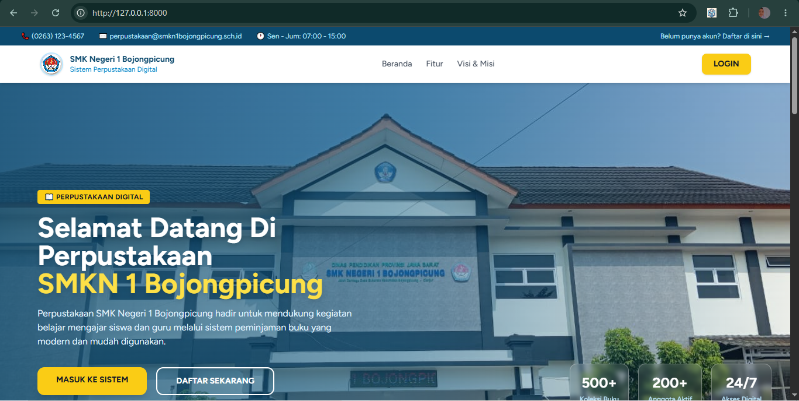
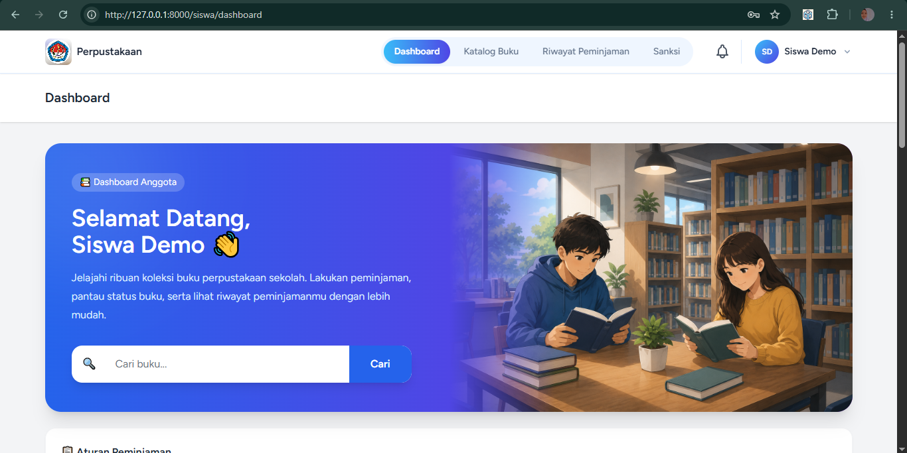
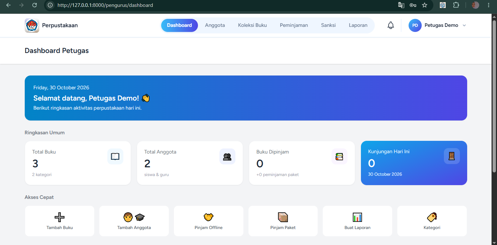
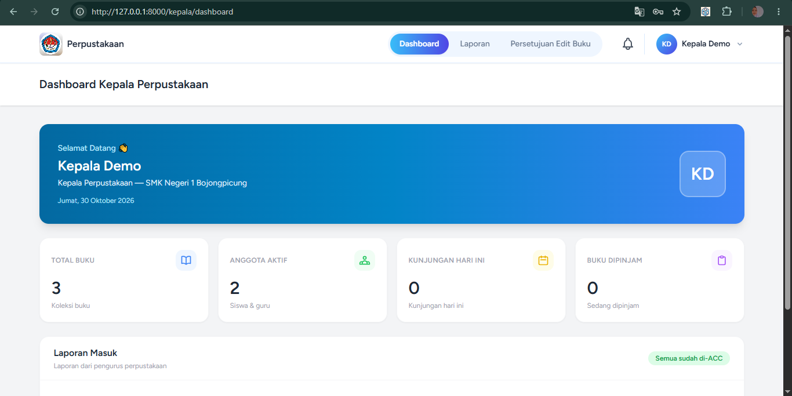

# Sistem Perpustakaan Digital SMKN 1 Bojongpicung

Sistem informasi perpustakaan berbasis website untuk menggantikan pencatatan manual di perpustakaan SMK Negeri 1 Bojongpicung. Dibuat sebagai proyek skripsi menggunakan **Laravel 12** dan **MySQL**.


## Tampilan Aplikasi

| Beranda | Dashboard Siswa |
|---|---|
|  |  |

| Dashboard Petugas | Dashboard Kepala |
|---|---|
|  |  |

## Fitur Utama

Aplikasi memiliki 4 jenis pengguna:

| Peran | Hak Akses |
|---|---|
| **Siswa** | Melihat katalog, meminjam (booking) buku, melihat riwayat, menyelesaikan sanksi, menerima notifikasi |
| **Guru** | Hak akses sama dengan siswa |
| **Petugas Perpustakaan** | Mengelola anggota, koleksi buku, peminjaman, pengembalian, sanksi, notifikasi, dan laporan |
| **Kepala Perpustakaan** | Memantau statistik dan meninjau laporan dari petugas |

### Siswa dan Guru
- Registrasi mandiri (siswa) dan login berdasarkan peran
- Pencarian katalog berdasarkan judul, pengarang, atau kategori
- Booking buku dengan batas maksimal 3 buku yang sedang dipinjam
- Riwayat peminjaman dan notifikasi status
- Upload bukti penyelesaian sanksi

### Petugas Perpustakaan
- Manajemen anggota (tambah, ubah, nonaktifkan, hapus) dengan pencarian dan filter peran
- Manajemen koleksi buku dan kategori, termasuk unggah sampul
- Persetujuan (ACC) peminjaman dan konfirmasi pengembalian dengan pengecekan kondisi buku
- Peminjaman paket dan peminjaman offline
- Verifikasi bukti sanksi (terima atau tolak)
- Pencatatan kunjungan
- Laporan per periode dengan grafik, dapat diunduh atau dicetak sebagai PDF lalu dikirim ke kepala

### Kepala Perpustakaan
- Dashboard statistik aktivitas perpustakaan
- Meninjau laporan: menyetujui, menolak, atau memberi catatan koreksi
- Menindaklanjuti permintaan edit buku

### Fitur Sistem
- Kode otomatis untuk anggota, buku, dan transaksi (contoh: `BUKFIK001`, `PJMSIS130625001`)
- Notifikasi otomatis untuk status peminjaman, sanksi, dan pengingat batas pengembalian (termasuk email)
- Pengecekan keterlambatan otomatis berdasarkan tanggal kembali

## Alur Peminjaman dan Pengembalian

```
Anggota booking -> Petugas ACC -> Anggota ambil buku
   -> Buku dikembalikan -> Petugas cek kondisi
   -> Baik: Selesai  |  Rusak / Terlambat: Sanksi
   -> Anggota upload bukti -> Petugas verifikasi -> Selesai
```

**Aturan penting**
- Maksimal 3 buku yang sedang dipinjam per anggota
- Tanggal pengambilan booking maksimal 2 hari kerja
- Stok berkurang saat booking dan kembali setelah buku dikembalikan dalam kondisi baik
- Keterlambatan dikenai sanksi kegiatan positif yang dibuktikan dengan dokumentasi
- Buku rusak dikenai sanksi penggantian buku yang dibuktikan dengan unggahan bukti

## Teknologi

| Komponen | Keterangan |
|---|---|
| Bahasa | PHP 8.2+ |
| Framework | Laravel 12 |
| Database | MySQL |
| Frontend | Blade, Tailwind CSS, Alpine.js, Axios |
| Build tool | Vite |
| Testing | PHPUnit (Feature dan Unit test bawaan Laravel) |
| Server lokal | XAMPP (Apache + MySQL) |

## Cara Instalasi

**Prasyarat:** PHP 8.2+, Composer, Node.js dan npm, MySQL (misalnya lewat XAMPP), dan Git.

```bash
# 1. Clone repository
git clone https://github.com/Yeshiana/sistem-perpustakaan-laravel.git
cd sistem-perpustakaan-laravel

# 2. Pasang dependensi
composer install
npm install
npm run build

# 3. Siapkan konfigurasi
copy .env.example .env      # Windows (di Linux/Mac: cp .env.example .env)
php artisan key:generate
```

Buat database kosong bernama `db_perpustakaan` lewat phpMyAdmin (`http://localhost/phpmyadmin`), lalu sesuaikan bagian database di `.env`:

```env
DB_CONNECTION=mysql
DB_HOST=127.0.0.1
DB_PORT=3306
DB_DATABASE=db_perpustakaan
DB_USERNAME=root
DB_PASSWORD=
```

> Pada XAMPP bawaan, username `root` dengan password kosong. Hanya untuk lokal; jangan dipakai di server publik.

Lanjutkan dengan:

```bash
# 4. Buat tabel, isi akun demo, dan tautkan storage (untuk sampul buku dan bukti unggahan)
php artisan migrate --seed
php artisan storage:link

# 5. Jalankan aplikasi
php artisan serve
```

Buka `http://127.0.0.1:8000` di browser.

Untuk mengakses dari smartphone atau komputer lain di jaringan Wi-Fi yang sama, jalankan `php artisan serve --host=0.0.0.0` lalu buka `http://[IP-komputer]:8000`.

## Akun Demo

Akun berikut dibuat otomatis oleh `php artisan migrate --seed`. Password semuanya: `demo12345`

| Peran | Username | Halaman login |
|---|---|---|
| Siswa | `0000000001` | `/login` |
| Guru | `Guru Demo` | `/login` |
| Petugas | `Petugas Demo` | `/admin/login` |
| Kepala | `Kepala Demo` | `/admin/login` |

> Seluruh data pada aplikasi ini adalah data dummy. Seeder akun demo tidak berjalan di environment `production`.

## Testing

Aplikasi ini diuji secara manual maupun otomatis.

- **Pengujian manual (test case dan bug report):** [qa-manual-portfolio / library-system-testing](https://github.com/Yeshiana/qa-manual-portfolio/tree/main/library-system-testing)
- **Pengujian otomatis (PHPUnit):**

```bash
php artisan test
```

## Pemecahan Masalah

| Masalah | Solusi |
|---|---|
| Error koneksi database (`SQLSTATE`) | Pastikan MySQL aktif di XAMPP dan cek `DB_DATABASE`, `DB_USERNAME`, `DB_PASSWORD` di `.env` |
| Tabel tidak ditemukan | Jalankan `php artisan migrate --seed` |
| Tidak bisa login | Pastikan `migrate --seed` sudah dijalankan. Petugas dan kepala login lewat `/admin/login` |
| `No application encryption key` | Jalankan `php artisan key:generate` |
| Sampul buku atau bukti unggahan tidak tampil | Jalankan `php artisan storage:link` |
| Halaman error setelah mengubah `.env` | Jalankan `php artisan config:clear` |
| Port 8000 sudah dipakai | Jalankan `php artisan serve --port=8001` |
| Folder `vendor` tidak ada | Jalankan `composer install` |
| Tampilan tidak termuat (CSS/JS) | Jalankan `npm install` lalu `npm run build` |

## Penyusun

**Yeshiana**
Informatika, Universitas Wanita Internasional
GitHub: [@Yeshiana](https://github.com/Yeshiana)

Aplikasi ini dikembangkan sebagai bagian dari penelitian skripsi di SMK Negeri 1 Bojongpicung, Kabupaten Cianjur, Jawa Barat.
